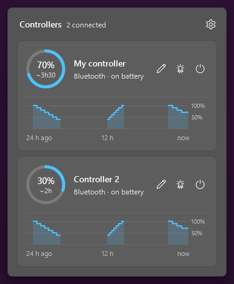
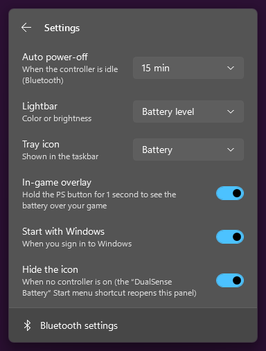
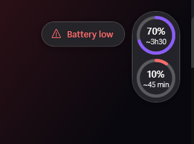
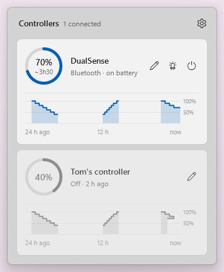
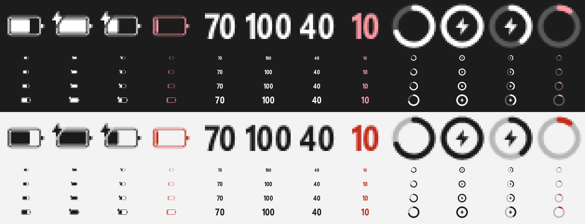

# DualSense Battery

**See your PS5 DualSense controller battery in the Windows taskbar.** It looks and feels like a built-in Windows 11 flyout. It adds an in-game overlay, low-battery alerts on the controller itself, auto power-off and lightbar control.

One tiny `.exe` (~170 KB). No installer, no Steam, no drivers, no internet.

<p align="center">
  
  &nbsp;
  
</p>

## Features

- **Taskbar icon with the battery level.** You can show it as the Windows battery glyph, a percentage or a ring. It follows your light/dark theme and the icon turns red when the battery is low.
- **Native-looking flyout.** Left-click opens a Windows 11 panel with acrylic, rounded corners, your accent color and the system animations. It shows one card per controller:
  - a battery ring with the **estimated time left** (or time until full while charging);
  - a **24-hour battery graph** (hover it for details);
  - **Rename**, **Identify** (the controller flashes and rumbles) and **Turn off** buttons.
- **In-game overlay.** Hold the **PS button for 1 second** to see every controller's battery on top of your game. It never steals focus from the game.
- **Low-battery alerts at 10% and 5%.** You get a Windows notification and the overlay, and **the controller rumbles and flashes red** so you notice it mid-game.
- **Auto power-off over Bluetooth.** An idle controller is turned off after 10, 15, 30 or 60 minutes, or never. Idle means no buttons, sticks, triggers or touchpad.
- **Lightbar control.** Blue, dim, off, or **battery level**: the lightbar fades from blue to purple to red as the battery drains, and pulses orange when it's almost empty.
- **Multiple controllers.** Each one is recognized by its Bluetooth address, over USB or Bluetooth. Controllers you used recently stay listed, greyed out, with their last known level.
- **Learns your controller.** Time-left and charge-time estimates adapt to how fast your controller actually drains and charges.
- **English and French.** The language follows Windows.

<p align="center">
  
  &nbsp;
  
</p>

<p align="center">
  
</p>

## Download

1. Grab **`DualSenseBattery.exe`** from the [latest release](../../releases/latest).
2. Put it anywhere and run it. It starts with Windows by default, and you can turn that off in the settings.
3. Turn your controller on: the icon appears in the taskbar.

Windows SmartScreen may warn you because the exe isn't code-signed. Click **More info → Run anyway**, or [build it yourself](#build-from-source) from the source in this repo.

**Requirements:**
- Windows 11. Windows 10 should work but without the acrylic look; this is untested.
- A **DualSense** controller over Bluetooth or USB. The **DualSense Edge** is detected too but is untested.
- .NET Framework 4.8, which is already part of Windows 10 and 11.

## Usage

| Action | Result |
|---|---|
| Left-click the icon | Open the flyout |
| Right-click the icon | Quick menu: hide the icon, Bluetooth settings, quit |
| Hold the PS button ~1 s | In-game overlay |
| ⚙ in the flyout | Settings |
| Start menu → *DualSense Battery* | Reopen the flyout when the icon is hidden |

The in-game overlay works over borderless/windowed games. Like any overlay that isn't injected into the game, it can't appear over *exclusive* fullscreen.

## How it works

The app reads the controller's HID input reports directly with Windows' own `hid.dll`, about 10 times per second. No driver or background service is involved.

- **Battery:** the battery level and charging state are a byte in the full input report.
- **Bluetooth full reports:** over Bluetooth the controller only sends short reports until you request feature report `0x05` at the length the driver reports (547 bytes on Windows).
- **Lightbar and rumble:** these use output report `0x31` with a CRC32 over Bluetooth, or `0x02` over USB.
- **Power-off:** the app disconnects the controller from the Bluetooth radio, and the DualSense then shuts down by itself.

Everything is in one C# file, [`src/DualSenseBattery.cs`](src/DualSenseBattery.cs), with WPF for the UI and Win32/DWM for the native look.

**Privacy:** the app makes no network connections and collects nothing. Settings are stored in `HKCU\Software\DualSenseBattery`. The log and the 48-hour history are in `%LOCALAPPDATA%\DualSenseBattery`.

**Note:** if Steam Input or DS4Windows also controls the lightbar, the two apps may override each other's color.

## Build from source

No SDK needed: Windows already ships the C# compiler.

```bat
git clone https://github.com/julienlrzl/DualSense-Battery
cd DualSense-Battery
build.cmd
```

The result is `bin\DualSenseBattery.exe`. To render the screenshots in `docs/`, run `DualSenseBattery.exe --demo <scenario> <file.png>`.

## Uninstall

1. Right-click the icon → **Quit**.
2. Delete the exe.
3. Delete `%LOCALAPPDATA%\DualSenseBattery`.
4. Delete the *DualSense Battery* shortcut in the Start menu.
5. Optionally, delete the registry key `HKCU\Software\DualSenseBattery`. Turning off **Start with Windows** before quitting removes the startup entry.

## Credits

The card-and-ring layout was inspired by [sdsc-utils](https://github.com/LankyMoose/sdsc-utils). This project is not affiliated with Sony. PlayStation and DualSense are trademarks of Sony Interactive Entertainment.

## License

[MIT](LICENSE)
